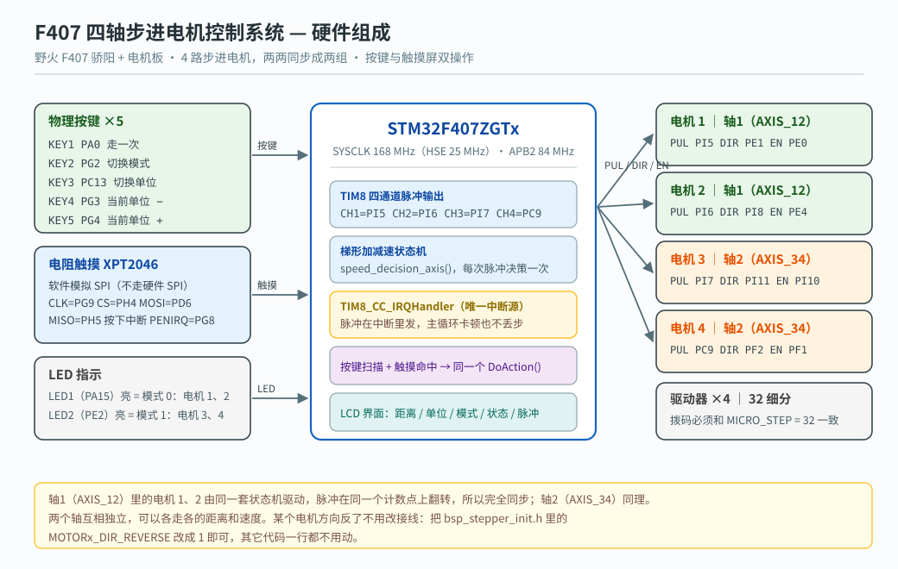
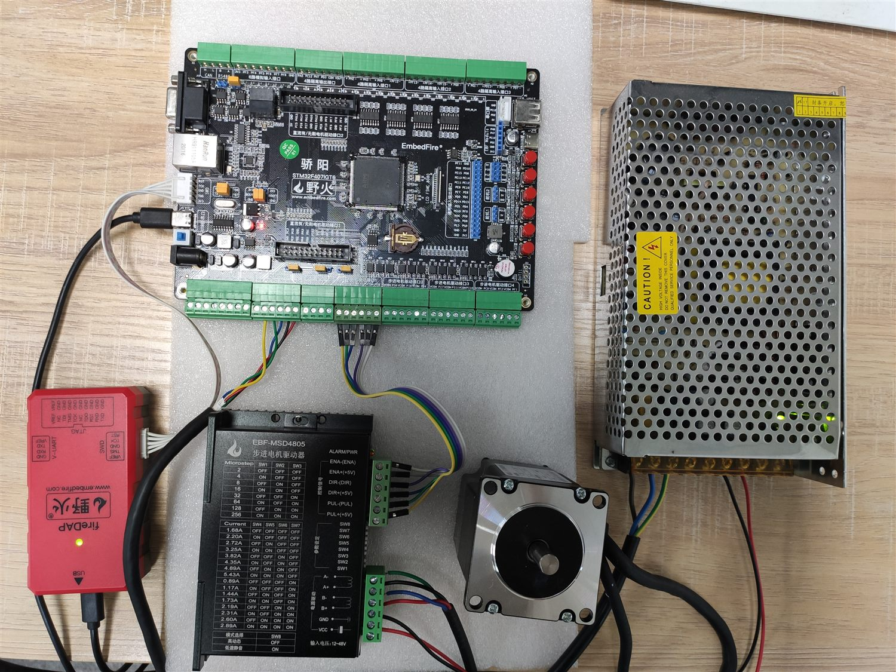
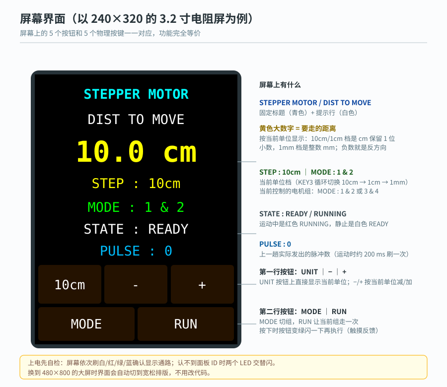
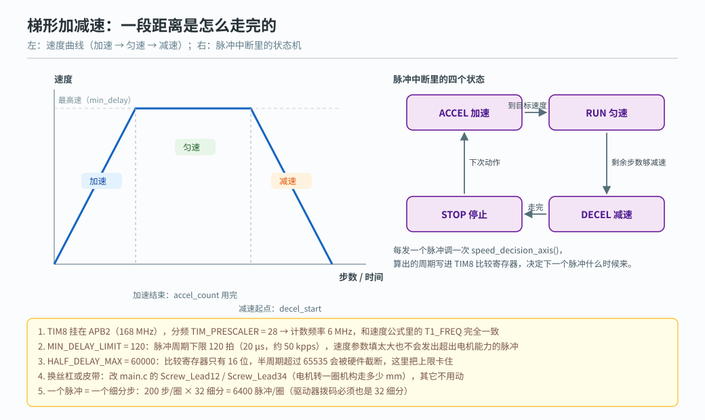

# F407-Motor-Control

基于**野火 STM32F407 骄阳开发板 + 电机板**的四轴步进电机控制程序。
四个电机分成两组（电机 1+2、电机 3+4）分别做**完全同步**的运动，用
**梯形加减速**走指定的距离；操作方式有**5 个物理按键**和**电阻触摸屏**两套，功能完全等价。



---

## 一、功能

| 模块 | 说明 |
| --- | --- |
| **四路步进电机** | 4 个脉冲脚全在 TIM8 上（CH1~CH4），一个中断服务函数搞定；方向 (DIR) 与使能 (EN) 用普通 IO |
| **两两同步** | 轴1 = 电机 1+2，轴2 = 电机 3+4。同一轴的脉冲在同一个计数点上翻转，所以两个电机完全同步，不会跑偏 |
| **梯形加减速** | 加速 → 匀速 → 减速，速度曲线由 TIM8 比较中断里的状态机算出来 |
| **双操作方式** | 5 个物理按键 + 屏幕上的 5 个按钮，走同一套动作分发 `DoAction()` |
| **三档单位** | 10 cm / 1 cm / 1 mm 循环切换，加减按当前档位走 |
| **距离可正可负** | 负值就是反方向（不用倒接线） |
| **屏幕自动识别** | 支持 ILI9341 / ST7789V（2.8、3.2 寸电阻屏）、ILI9806G（5 寸）、NT35510（4.3/4.5 寸） |
| **触摸校准** | 两点校准，结果写进 Flash，下次开机直接用；需要重校时上电按住屏幕即可 |
| **调试串口** | USART1 / 115200 8-N-1（代码里默认关掉了，见"已知问题"） |

## 二、硬件与接线



> 上面是缩略图；原图（4000×3000）在 `Doc/步进电机与电机板接线407.jpg`。

| 功能 | 引脚 | 说明 |
| --- | --- | --- |
| 电机 1 | PUL=**PI5**(TIM8_CH1)、DIR=**PE1**、EN=**PE0** | 电机板接口 1 |
| 电机 2 | PUL=**PI6**(TIM8_CH2)、DIR=**PI8**、EN=**PE4** | 电机板接口 2 |
| 电机 3 | PUL=**PI7**(TIM8_CH3)、DIR=**PI11**、EN=**PI10** | 电机板接口 3 |
| 电机 4 | PUL=**PC9**(TIM8_CH4)、DIR=**PF2**、EN=**PF1** | 电机板接口 4 |
| KEY1 / KEY2 | **PA0** / **PG2** | 走一次 / 切换模式 |
| KEY3 / KEY4 / KEY5 | **PC13** / **PG3** / **PG4** | 切单位 / 当前单位 − / 当前单位 + |
| LED1 / LED2 | **PA15** / **PE2** | 亮 = 当前处于模式 0（电机 1、2）/ 模式 1（电机 3、4） |
| LCD（FSMC 8080） | NE3 作片选，A0 作 RS；复位 **PF11**，背光 **PE5** | 16 位数据总线 |
| 触摸 XPT2046 | CLK=**PG9**、CS=**PH4**、MOSI=**PD6**、MISO=**PH5**、PENIRQ=**PG8** | 软件模拟 SPI，按下时 PENIRQ 变低 |
| 调试串口 USART1 | RX=**PB6**、TX=**PB7**（AF7） | 经板载 CH340 到电脑，115200 8-N-1 |

**驱动器细分必须是 32**（和代码里的 `MICRO_STEP` 一致），否则实际走的距离会和设定值差整数倍。

## 三、怎么操作

| 动作 | 物理按键 | 屏幕按钮 | 效果 |
| --- | --- | --- | --- |
| 走一次 | KEY1 (PA0) | `RUN` | 让**当前模式**那一组按设定距离走一次 |
| 切换模式 | KEY2 (PG2) | `MODE` | 模式 0 → 控制电机 1、2（LED1 亮）；模式 1 → 控制电机 3、4（LED2 亮） |
| 切换单位 | KEY3 (PC13) | `UNIT` | 10cm → 1cm → 1mm 循环 |
| 加 | KEY5 (PG4) | `+` | 按当前单位加一格（10cm 档一次加 100 mm） |
| 减 | KEY4 (PG3) | `−` | 按当前单位减一格；减到负数就是反方向走 |

两组距离是**分开记忆**的：模式 0 调的是电机 1、2 的距离，模式 1 调的是电机 3、4 的距离，
来回切模式不会互相覆盖。距离范围 ±1000 mm。

**距离是怎么变成脉冲的**：

```
脉冲数 = 距离(mm) × 6400 ÷ 每圈毫米数
        其中 6400 = 200 步/圈（1.8° 步距角）× 32 细分
        "每圈毫米数" 就是电机转一圈机构走多远：接丝杠就填导程，接齿轮/皮带就填对应的毫米数
```

## 四、屏幕显示



大屏（480×800 那种）会自动换成宽松排版，小屏（240×320）用紧凑排版——判断依据就是屏幕高度，
不用改代码。

## 五、目录结构

```
f407测试版/
├─ Project/                 Keil 工程：打开 Fire-F407.uvprojx
│   ├─ Fire-F407.uvprojx    工程文件
│   ├─ key.c                Key_Init()：5 个按键的 GPIO 配置
│   └─ build_*.log          编译日志（已被 .gitignore 排除）
├─ User/                    应用与驱动源码
│   ├─ main.c               主逻辑：按键扫描、DoAction() 动作分发、主循环
│   ├─ stepper/             四路脉冲 + 梯形加减速状态机
│   │   ├─ bsp_stepper_init.c/.h    引脚、TIM8 四通道、中断、轴分组
│   │   └─ bsp_stepper_T_speed.c/.h 加减速状态机与对外接口
│   ├─ lcd/                 屏幕与界面
│   │   ├─ bsp_lcd_display.c   FSMC 8080 总线 + 面板识别
│   │   ├─ bsp_ili9341_lcd.c   ILI9341 / ST7789V
│   │   ├─ ili9806g.c / nt35510.c  5 寸 / 4.3 寸面板
│   │   ├─ lcd_draw.c / fonts.c    画点画线、ASCII 字库
│   │   ├─ bsp_ui.c            界面布局与刷新
│   │   └─ bsp_touch.c         XPT2046 触摸 + 两点校准
│   ├─ led/                  LED 驱动
│   ├─ delay/                DWT 延时（重写了 HAL_InitTick）
│   ├─ usart/                调试串口
│   ├─ kkey/key.h            按键接口声明
│   ├─ key/bsp_exti.c        例程遗留的 EXTI 按键（当前用轮询，未使用）
│   └─ stm32f4xx_it.c        中断入口（TIM8_CC_IRQHandler 在这里）
├─ Libraries/               CMSIS + STM32F4xx HAL 库
├─ Doc/                     接线图 + 原例程说明
├─ Output/                  Keil 输出（仓库里只保留散列文件 YH-F407.sct）
└─ Listings/                Keil 编译清单（产物）
```

## 六、工作原理



### 1. 两个电机为什么能完全同步

4 个脉冲脚都在 TIM8 上，但**只用其中一路产生中断**：轴的"节拍"通道（CH1/CH3）触发中断，
中断里给"跟随"通道（CH2/CH4）写**同样的比较值**，两路输出就会在同一个计数点上一起翻转，
电机自然完全一致——比在主循环里分别调用两个电机强得多，不会因为先后差几个微秒而跑偏。

### 2. 脉冲在中断里发，不在主循环

主循环只负责扫按键、算距离、刷屏幕。发脉冲完全由 TIM8 中断驱动，所以就算主循环在刷一大片
屏幕、触摸在等手松开，脉冲节拍也不会被拖慢——这是"丢步"最常见的原因之一。

### 3. 梯形加减速

每次脉冲（中断）调用一次 `speed_decision_axis()`，按 `STOP → ACCEL → RUN → DECEL → STOP`
的状态机算出下一个脉冲的周期，写进比较寄存器。加速区步数 `accel_count` 用完就进匀速，
走到 `decel_start` 就开始减速，直到把设定的脉冲数走完。

### 4. TIM8 分频为什么是 28

TIM8 挂在 APB2（168 MHz）。原来初始化写的是 5，而速度公式里按 `168/(5+1) = 28 MHz` 计算，
两边差了 20%，实际速度比设定值快两成，调参时会误导人。改成 `TIM_PRESCALER = 28` 之后
计数频率 = `168/28 = 6 MHz`，和公式里的 `T1_FREQ` 完全对齐。

不用更细的 28 MHz 是因为**比较寄存器只有 16 位**：半周期超过 65535 拍会被硬件截断，
起步第一拍的周期会比曲线算出来的短 3 倍多，恰恰是最容易丢步的地方。6 MHz 下起步周期约
56834 拍，一半是 28417，正好在范围内。

### 5. 两道防丢步的软件保护

| 宏 | 作用 |
| --- | --- |
| `MIN_DELAY_LIMIT = 120` | 脉冲周期下限 120 拍 = 20 µs（约 50 kpps）。速度参数填得再大，也不会发出超出电机能力的脉冲 |
| `HALF_DELAY_MAX = 60000` | 半周期上限。超过 65535 会被 16 位寄存器截断，把上下限卡住曲线才不会变形 |

### 6. HAL_Delay 走的是 DWT，不是 SysTick

`core_delay.c` 重写了 `HAL_InitTick()`，把它改成"使能 DWT 周期计数器"，`HAL_GetTick()`
和 `HAL_Delay()` 都基于 DWT。这样 **SysTick 中断不参与**，不会和 TIM8 的脉冲节拍抢中断，
屏幕上刷字用 `HAL_Delay()` 也不会影响电机。

### 7. 屏幕：FSMC 8080 + 面板自动识别

LCD 用 FSMC 的 8080 模式（NE3 作片选、A0 作 RS）。开机先读面板 ID 再按型号初始化；
读不到 ID 时会按 `bsp_ili9341_lcd.h` 里的 `ILI9341_FORCE_ID` 走。
背光极性由 `ILI9341_BL_ACTIVE_LOW` 决定——如果烧完屏幕"先白后黑"，就是这个极性反了。

### 8. 触摸：软件 SPI + 两点校准

XPT2046 用普通 IO 模拟 SPI（不占硬件 SPI）。校准数据存在 Flash 里：
第一次用（没有校准数据）时，随便按住屏幕一下就会进两点校准；之后再开机直接用，
想重新校准就上电时按住屏幕不放。

## 七、编译与烧录

| 项目 | 值 |
| --- | --- |
| 工具链 | Keil MDK5（ARMCC V5.06 / AC5，工程里 `uAC6 = 0`） |
| 器件 | STM32F407ZGTx |
| 目标名 | `TIM`（沿用了原例程的名字） |
| 输出 | `Output\YH-F407.axf` |
| 运行库 | MicroLIB |
| 上次全量编译 | Code=17768、RO-data=37076、RW-data=252、ZI-data=1348（约 54 KB），**0 Error / 21 Warning** |

图形界面：Keil 打开 `Project\Fire-F407.uvprojx`，Build 后直接 Download。

命令行编译：

```bat
"C:\Keil_v5\UV4\UV4.exe" -b "Project\Fire-F407.uvprojx" -t TIM -j0 -o build.log
```

**需要注意的三点**

1. **工程没有开"生成 HEX"**（`CreateHexFile = 0`），只输出 `.axf`。要用 hex 烧录的话，
   在 Options for Target → Output 里勾上 `Create HEX File` 再编译。
2. **大部分源码是 GBK 编码**（Keil 中文环境），用别的编辑器改完请另存为 ANSI/GBK；
   存成 UTF-8 会报 `#870-D: invalid multibyte character sequence`。
3. 那 21 个 Warning 都是无害的：15 个"文件最后一行没有换行"、4 个"枚举类型与其它类型混用"、
   1 个 `Key_Init` 声明没写参数类型、1 个变量赋值后未使用。

## 八、调参指南

| 想改什么 | 改哪里 | 说明 |
| --- | --- | --- |
| 走多快 | `main.c` 的 `set_speed` | 单位 0.1 rad/s。`100` ≈ 10 rad/s ≈ 95 转/分（接 5 mm 丝杠约 8 mm/s） |
| 加/减速快慢 | `main.c` 的 `accel_val` / `decel_val` | 单位 0.1 rad/s²，越大越"窜" |
| 默认距离 | `main.c` 的 `Motor_Distance12` / `Motor_Distance34` | 单位 mm，可正可负 |
| 每圈走多少毫米 | `main.c` 的 `Screw_Lead12` / `Screw_Lead34` | 接丝杠填导程（5 mm 就填 5）；接齿轮/皮带填对应毫米数 |
| 距离上限 | `main.c` 的 `DIST_MAX` | 默认 1000 mm |
| 电机方向反了 | `bsp_stepper_init.h` 的 `MOTORx_DIR_REVERSE` | 改成 1 即可，不用倒接线 |
| 驱动器细分 | `bsp_stepper_T_speed.h` 的 `MICRO_STEP` | 必须和驱动器拨码一致（当前 32）；改它，每圈脉冲数 SPR 跟着变 |

**丢步了怎么办**（现象：走完位置不对、有"咯噔"声、走一段就偏）：

1. 先把 `set_speed` / `accel_val` / `decel_val` 都调小一半，确认不丢了再一点点加回去；
2. 确认驱动器拨码是 **32 细分**，并且电机电流够（太小会丢步，太大会发热）；
3. 检查机械：丝杠/导轨有没有卡、联轴器有没有松；
4. 两个电机同步的那一组如果"越走越歪"，多半是其中一个驱动器细分数或电流设得不一样。

## 九、已知问题 / 待办

- `main.c` 里的 `DEBUG_USART_Config()` 被注释掉了，**串口调试暂时没启用**。
  要用就把那行注释去掉（USART1 / PB6、PB7 / 115200 8-N-1）。
- `User/kkey/key.h` 里的声明是 `void Key_Init();`（没写参数类型），会有 1 个 Warning；
  改成 `void Key_Init(void);` 即可。
- `ILI9341_FORCE_ID` 目前**写死成 `LCDID_ST7789V`**（对应野火 3.2 寸现产面板）。
  换 2.8 寸（ILI9341）或 4.3/5 寸面板时要改这个宏，或把它设成 0 让它自动读 ID。
- 同一组的两个电机**只能同时、同距离**运动（共用一套状态机）；四个电机不能各走各的。
  这是设计取舍：换来的是两个电机的脉冲严格同步。
- `User/tim/bsp_general_tim.c`、`User/key/bsp_exti.c` 是例程遗留（前者没在工程里编译，
  后者被编译但当前用的是轮询按键，没被调用）。
- `Project/.git_unused_20261013` 是之前在 `Project/` 里误 `git init` 留下的空仓库备份
  （没有任何提交），已被 `.gitignore` 排除，可以放心删掉。

## 十、第三方代码与许可

| 组件 | 来源 / 许可 |
| --- | --- |
| `Libraries/`（STM32F4xx HAL + CMSIS） | STMicroelectronics，BSD-3-Clause |
| `User/lcd/` 的屏幕与触摸驱动 | 基于野火 F407 骄阳官方 LCD/触摸例程修改 |
| `User/stepper/` | 基于野火官方"步进电机-梯形加减速"例程修改（原说明见 `Doc/readme.txt`） |
| `User/delay/core_delay.c` | 野火 core_delay（DWT 延时） |
| 其余应用代码（`main.c`、`bsp_ui.c`、按键/界面整合、双操作逻辑等） | 本项目作者 |
